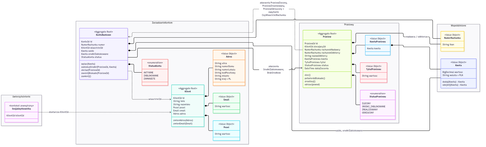

# Zadanie 1 – Domain Driven Design: fragment systemu bankowego

## Opis zadania

Celem zadania jest zamodelowanie bezpiecznego fragmentu aplikacji bankowej z wykorzystaniem zasad Domain Driven Design.
Wybrany fragment obejmuje dwa główne konteksty ograniczone – **Zarządzanie Kontem** oraz **Przelewy** – oraz zewnętrzny kontekst **Uwierzytelnienie**, który dostarcza tożsamość zalogowanego klienta.
W modelu zdefiniowano trzy agregaty (Klient, KontoBankowe, Przelew) oraz obiekty wartości opisujące dane wrażliwe i finansowe (`Adres`, `Pesel`, `Email`, `NumerRachunku`, `Kwota`, `KwotaPrzelewu`, `TytulPrzelewu`).
Dla każdego elementu określono dopuszczalne formaty danych i niezmienniki, które są sprawdzane już w momencie tworzenia obiektu, dzięki czemu w domenie nie mogą istnieć obiekty w niepoprawnym stanie.

## Model

Źródło diagramu (Mermaid): [`docs/ddd-model.mmd`](docs/ddd-model.mmd)

## Konteksty ograniczone (Bounded Contexts)

| Kontekst | Odpowiedzialność | Agregaty |
|---|---|---|
| **Uwierzytelnienie** (zewnętrzny, upstream) | Logowanie klienta, sesja, dostarczenie `KlientId` zalogowanego użytkownika. Nie jest modelowany szczegółowo. | – |
| **Zarządzanie Kontem** | Dane klienta, otwieranie i zamykanie rachunków, saldo, blokady środków. | `Klient`, `KontoBankowe` |
| **Przelewy** | Zlecanie przelewów krajowych i śledzenie ich cyklu życia. | `Przelew` |

Obiekty `NumerRachunku` i `Kwota` należą do współdzielonego jądra (*Shared Kernel*), z którego korzystają oba konteksty.

## Agregaty, encje i obiekty wartości – przyjęte założenia

### Ogólne zasady

| Zasada | Opis |
|---|---|
| Walidacja przy tworzeniu | Każdy obiekt wartości i encja waliduje dane w konstruktorze/fabryce. Niepoprawne dane powodują wyjątek domenowy, obiekt nie powstaje. |
| Niezmienność obiektów wartości | Obiekty wartości są niemutowalne; zmiana oznacza utworzenie nowego obiektu (np. `Kwota.dodaj()` zwraca nową kwotę). |
| Identyfikatory | `KlientId`, `KontoId`, `PrzelewId` to UUID v4 – nieprzewidywalne, nie da się ich zgadywać (ochrona przed IDOR). |
| Referencje między agregatami | Agregaty odwołują się do siebie wyłącznie przez identyfikatory (np. `KontoBankowe.wlascicielId`), nigdy przez bezpośrednie obiekty. |
| Normalizacja | Przed walidacją dane tekstowe są przycinane (`trim`), a IBAN dodatkowo pozbawiany spacji i zamieniany na wielkie litery. |
| Lista dozwolonych znaków | Pola tekstowe są walidowane białą listą znaków (*allowlist*), a nie czarną listą. Znaki `<`, `>`, `"`, `'`, `` ` ``, `;`, `{`, `}` nie są dopuszczalne w żadnym polu tekstowym. |
| Pieniądze | Kwoty przechowywane jako liczba dziesiętna o stałej precyzji (`BigDecimal`, skala 2) – nigdy jako `float`/`double`. |

### Agregat `Klient` (kontekst Zarządzanie Kontem)

| Element | Typ | Atrybut | Ograniczenia / format |
|---|---|---|---|
| Klient | Encja, korzeń agregatu | `id` | UUID v4, nadawany przez system |
| | | `imie` | 1–50 znaków; litery (w tym polskie), spacja, `-` |
| | | `nazwisko` | 1–80 znaków; litery (w tym polskie), spacja, `-` |
| | | `pesel` | obiekt wartości `Pesel` |
| | | `email` | obiekt wartości `Email` |
| | | `adres` | obiekt wartości `Adres` |
| Pesel | Obiekt wartości | `wartosc` | dokładnie 11 cyfr, poprawna cyfra kontrolna, poprawna data urodzenia zakodowana w numerze; w logach maskowany (`*******1234`) |
| Email | Obiekt wartości | `wartosc` | maks. 254 znaki, format `lokalna@domena.tld`, zapisywany małymi literami |
| Adres | Obiekt wartości | `ulica` | 1–100 znaków; litery, cyfry, spacja, `. - /` |
| | | `numerDomu` | 1–10 znaków; cyfry z opcjonalną literą, np. `12A` |
| | | `numerLokalu` | opcjonalny, 1–10 znaków; cyfry z opcjonalną literą |
| | | `kodPocztowy` | format `NN-NNN` (regex `^\d{2}-\d{3}$`) |
| | | `miasto` | 1–50 znaków; litery (w tym polskie), spacja, `-` |
| | | `kraj` | stała wartość `PL` |

Operacje: `zmienAdres(Adres)`, `zmienEmail(Email)`. PESEL jest niezmienny po utworzeniu klienta.

### Agregat `KontoBankowe` (kontekst Zarządzanie Kontem)

| Element | Typ | Atrybut | Ograniczenia / format |
|---|---|---|---|
| KontoBankowe | Encja, korzeń agregatu | `id` | UUID v4 |
| | | `numer` | obiekt wartości `NumerRachunku`, unikalny w systemie |
| | | `wlascicielId` | `KlientId` istniejącego klienta |
| | | `saldo` | obiekt wartości `Kwota`, zawsze `>= 0` (brak debetu) |
| | | `srodkiZablokowane` | obiekt wartości `Kwota`, `0 <= srodkiZablokowane <= saldo` |
| | | `status` | `AKTYWNE`, `ZABLOKOWANE`, `ZAMKNIETE` |
| NumerRachunku | Obiekt wartości (Shared Kernel) | `iban` | polski IBAN: `PL` + 26 cyfr (regex `^PL\d{26}$` po normalizacji), poprawna suma kontrolna mod 97 |
| Kwota | Obiekt wartości (Shared Kernel) | `wartosc` | liczba dziesiętna, `>= 0`, maks. 2 miejsca po przecinku |
| | | `waluta` | stała wartość `PLN` |

Operacje i niezmienniki:
- `wplac(Kwota)` – kwota `> 0`, konto `AKTYWNE`.
- `zablokujSrodki(PrzelewId, Kwota)` – możliwe tylko, gdy `saldo - srodkiZablokowane >= kwota`; w przeciwnym razie zdarzenie `BrakSrodkow`.
- `obciaz(PrzelewId)` – zmniejsza saldo o wcześniej zablokowaną kwotę danego przelewu.
- `zwolnijBlokade(PrzelewId)` – zwalnia blokadę po odrzuceniu przelewu.
- `zamknij()` – możliwe tylko przy saldzie równym `0` i braku blokad.
- Na kontach `ZABLOKOWANE` i `ZAMKNIETE` nie można wykonywać operacji finansowych.

### Agregat `Przelew` (kontekst Przelewy)

| Element | Typ | Atrybut | Ograniczenia / format |
|---|---|---|---|
| Przelew | Encja, korzeń agregatu | `id` | UUID v4 |
| | | `zlecajacyId` | `KlientId` z kontekstu Uwierzytelnienie; musi być właścicielem rachunku nadawcy |
| | | `rachunekNadawcy` | `NumerRachunku` |
| | | `rachunekOdbiorcy` | `NumerRachunku`, różny od rachunku nadawcy |
| | | `nazwaOdbiorcy` | 1–70 znaków; litery (w tym polskie), cyfry, spacja, `. , -` |
| | | `kwota` | obiekt wartości `KwotaPrzelewu` |
| | | `tytul` | obiekt wartości `TytulPrzelewu` |
| | | `status` | `StatusPrzelewu` |
| | | `dataZlecenia` | znacznik czasu UTC nadawany przez system (nie przez klienta) |
| KwotaPrzelewu | Obiekt wartości | `kwota` | `Kwota` w zakresie `0.01 – 100 000.00 PLN` |
| TytulPrzelewu | Obiekt wartości | `wartosc` | 1–140 znaków; litery (w tym polskie), cyfry, spacja, `. , - / ( ) :` |
| StatusPrzelewu | Typ wyliczeniowy | – | `ZLECONY`, `SRODKI_ZABLOKOWANE`, `ZREALIZOWANY`, `ODRZUCONY` |

Dozwolone przejścia statusów (tylko do przodu, stany końcowe są niezmienne):

| Z | Do | Wyzwalacz |
|---|---|---|
| – | `ZLECONY` | `zlec()` – utworzenie poprawnego przelewu |
| `ZLECONY` | `SRODKI_ZABLOKOWANE` | `potwierdzBlokade()` – po zdarzeniu `SrodkiZablokowane` z kontekstu Zarządzanie Kontem |
| `ZLECONY` | `ODRZUCONY` | `odrzuc(powod)` – po zdarzeniu `BrakSrodkow` lub gdy konto jest nieaktywne |
| `SRODKI_ZABLOKOWANE` | `ZREALIZOWANY` | `zrealizuj()` – rozliczenie przelewu |
| `SRODKI_ZABLOKOWANE` | `ODRZUCONY` | `odrzuc(powod)` – np. błąd rozliczenia, blokada zostaje zwolniona |

## Integracja pomiędzy kontekstami

| Zdarzenie / zapytanie | Nadawca → Odbiorca | Skutek |
|---|---|---|
| `KlientId` zalogowanego użytkownika | Uwierzytelnienie → Przelewy, Zarządzanie Kontem | Każda operacja jest wykonywana w imieniu tożsamości z sesji, nigdy z identyfikatora podanego w żądaniu. |
| `CzyWlascicielRachunku(KlientId, NumerRachunku)` | Przelewy → Zarządzanie Kontem | Przelew może być zlecony tylko z rachunku należącego do zlecającego. |
| `PrzelewZlecony(PrzelewId, rachunekNadawcy, kwota)` | Przelewy → Zarządzanie Kontem | Konto próbuje zablokować środki (`zablokujSrodki`). |
| `SrodkiZablokowane(PrzelewId)` | Zarządzanie Kontem → Przelewy | Przelew przechodzi w `SRODKI_ZABLOKOWANE`. |
| `BrakSrodkow(PrzelewId)` | Zarządzanie Kontem → Przelewy | Przelew przechodzi w `ODRZUCONY`. |
| `PrzelewZrealizowany(PrzelewId)` | Przelewy → Zarządzanie Kontem | Konto wykonuje `obciaz(PrzelewId)`. |
| `PrzelewOdrzucony(PrzelewId)` | Przelewy → Zarządzanie Kontem | Konto wykonuje `zwolnijBlokade(PrzelewId)`. |

Kontekst Przelewy nie modyfikuje bezpośrednio salda – zmiany stanu konta są wyłącznie odpowiedzialnością agregatu `KontoBankowe`, a komunikacja odbywa się przez zdarzenia domenowe (z warstwą antykorupcyjną po stronie odbiorcy, która tłumaczy zdarzenia na operacje własnego modelu).
